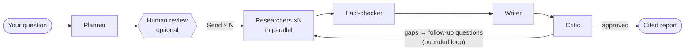

# Multi-Agent LangGraph Research System

**A team of AI agents that researches any question the way a careful human team would: it plans, searches in parallel, fact-checks its sources, writes a cited report, and critiques its own work.**

[](https://github.com/Arpan-ar7/multiagent-langgraph-research/actions/workflows/ci.yml)


> 📍 **New here? Start with [docs/START-HERE.md](docs/START-HERE.md)**: a guided reading path through the whole project, file by file.

---

## Why this project?

A chatbot answers from memory: it can be out of date, it hallucinates facts and URLs, and it never double-checks. A basic RAG app adds retrieval, but it is still a single LLM call.

This system **plans, works in parallel, verifies, critiques itself and iterates**:

- 🧭 **Plans:** splits your question into 3–5 focused sub-questions
- ⚡ **Researches in parallel:** one agent per sub-question searches the web, arXiv and Wikipedia at the same time (LangGraph `Send` map-reduce)
- 🔍 **Fact-checks:** claims citing URLs that were never actually retrieved are thrown out; contradictions between sources are flagged
- 📝 **Cites correctly by construction:** the LLM never writes a URL; code numbers the sources and builds the references
- 🔁 **Critiques itself:** a critic scores the report, and gaps trigger new research rounds (a bounded loop)
- 💾 **Never loses work:** every step is checkpointed to SQLite, so a crashed or quota-stopped run resumes where it stopped
- 🙋 **Human in the loop:** optionally pause to approve or edit the research plan
- 📊 **Measured:** an evaluation harness with deterministic metrics, LLM-as-judge and LangSmith

## How it works



| Agent | What it does | LLM decides | Code decides |
|---|---|---|---|
| **Planner** | Breaks the question into sub-questions and a report outline | the decomposition | limits, validation |
| **Researcher ×N** | ReAct tool-calling agent over Tavily, DuckDuckGo, arXiv and Wikipedia; returns claims tied to source URLs | what to search and read | which URLs were really retrieved; tool and model call limits |
| **Fact-checker** | Grounds every claim, scores source credibility, finds contradictions | contradictions | grounding, credibility |
| **Writer** | Turns verified claims into Markdown with `[n]` citations | the prose | source numbering, References, citation validation |
| **Critic** | Scores coverage, evidence use and coherence (1–5), proposes follow-ups | the scores | approval (threshold), loop limit |

> Design principle: **code does what rules can decide; the LLM is used only for judgement.**

## Example

```bash
uv run research "What is the LangGraph Send API used for?"
```

```
  [planner] planning
  [researcher] started: What is the LangGraph Send API and how is it officially defined?
  [researcher] done: What is the LangGraph Send API and how is it officially defined?
  [fact_checker] checking
  [writer] writing
  [critic] reviewing
  [finalize] done

Critic scores: coverage=4 evidence=3 coherence=5
Report saved to reports/20261119-what-is-the-langgraph-send-api-used-for.md
```

```markdown
# Research Report on the LangGraph Send API

## Definition and Official Overview of the LangGraph Send API
The Send API is formally defined as a `Send` class in the LangChain reference. It represents a
message or packet that is directed to a specific node, carrying a target node name and a state
(or partial state) payload. [2] ...

## References
1. https://docs.langchain.com/oss/python/langgraph/graph-api
2. https://reference.langchain.com/python/langgraph/types/Send
```

## Quick start

**Requirements:** Python 3.13 and [uv](https://docs.astral.sh/uv/). Free API keys for [OpenRouter](https://openrouter.ai) and [Tavily](https://tavily.com) (required), plus [LangSmith](https://smith.langchain.com) (recommended) and [Groq](https://console.groq.com) (optional).

```bash
git clone https://github.com/Arpan-ar7/multiagent-langgraph-research.git
cd multiagent-langgraph-research
uv sync                       # install everything from uv.lock
cp .env.example .env          # paste your API keys
uv run research "How are AI coding agents changing software engineering in 2026?"
```

## Ways to use it

### 1 · Command line

```bash
uv run research "your question"
uv run research "..." --sub-questions 3 --iterations 1   # cheaper run
uv run research "..." --review                           # approve or edit the plan first
uv run research --resume <thread-id>                     # continue a stopped run
```

### 2 · Web UI (FastAPI + Streamlit)

```bash
uv run research-api                          # terminal 1 → http://127.0.0.1:8000 (API docs at /docs)
uv run streamlit run ui/streamlit_app.py     # terminal 2 → http://localhost:8501
```

The UI shows a **live agent timeline**, a plan-approval step, the report with clickable citations, a source table with credibility scores, the critic's rubric, per-agent timings, a Markdown download, run history, and one-click resume of interrupted runs.

### 3 · Docker

```bash
cp .env.example .env
docker compose up --build    # API on :8000, UI on http://localhost:8501
```

One image serves both containers. Keys are read at runtime and never baked into the image.

### REST API

| Endpoint | Purpose |
|---|---|
| `POST /runs` | Start a run (`202`) and get a `thread_id` |
| `GET /runs/{id}/events` | Live progress as **Server-Sent Events** (replayable with `Last-Event-ID`) |
| `POST /runs/{id}/review` | Approve or narrow the plan of a paused run |
| `POST /runs/{id}/resume` | Continue an interrupted run |
| `GET /runs/{id}` · `/runs/{id}/report` · `/runs` · `/health` | State, Markdown report, history, status |

Runs execute in background threads, independent of HTTP connections, so closing the browser never stops a run.

## Reliability

| When this fails… | …the system does this |
|---|---|
| A model is rate-limited or down | The next model in the role's fallback chain answers |
| A transient error (429, 5xx, timeout) | Retry with exponential backoff |
| The daily quota runs out | No pointless retries: the run stops cleanly and can be resumed |
| One researcher fails | The others continue; the report lists the gap under "Limitations" |
| The fact-checker or critic fails | Graceful degradation with a warning |
| The LLM returns invalid structured output | Up to 2 repair attempts, showing the model its validation error |
| The process crashes | Resume from the last SQLite checkpoint; finished steps are not repeated |

## Evaluation

Benchmarked on 5 question types (technical, comparative, trend, factual, exploratory), comparing a **single pass** with the **critic loop**:

- **Deterministic metrics:** grounding rate, citation problems, sources, domains, critic iterations, LLM calls, tokens
- **LLM-as-judge:** relevance, completeness, specificity (1–5) on a separate model chain, to avoid self-preference bias
- **LangSmith:** dataset `research-system-benchmark`; every evaluated trace carries its scores as feedback

| Config × question | Relevance | Completeness | Specificity | Grounding | Sources (domains) | LLM calls |
|---|---|---|---|---|---|---|
| single_pass × technical | 5 | 4 | 5 | **1.00** | 22 (10) | 37 |

*More results are being added as the free-tier quota allows (the runner is resumable across days).*

```bash
uv run research-eval --dry-run       # verify the pipeline with stub agents (free)
uv run research-eval --max-runs 1    # real runs, resumable
uv run research-eval --summary       # results table
```

## Tech stack

| Area | Tools |
|---|---|
| Orchestration | **LangGraph** (StateGraph, reducers, `Send`, conditional edges, `interrupt`, SQLite checkpointer, streaming) |
| Agents | **LangChain** `create_agent`, middleware (model fallback, call limits), Pydantic structured output |
| Models | OpenRouter free models (Nemotron, Ernie, Ling) in role-based fallback chains; Groq (`gpt-oss`) as a rescue model |
| Search | Tavily (search + extract), DuckDuckGo, arXiv, Wikipedia |
| Backend / UI | FastAPI + Server-Sent Events, Streamlit |
| Observability & eval | LangSmith, structlog, LLM-as-judge |
| Engineering | uv, pytest (87 tests), mypy strict, ruff, pre-commit, Docker, GitHub Actions |

## Testing

```bash
uv run pytest                 # 87 unit + integration tests, ~30 s, no API keys needed
uv run pytest -m live         # smoke tests against real APIs (uses quota)
uv run ruff check . && uv run ruff format --check . && uv run mypy src ui
```

The graph depends only on agent *interfaces*, so integration tests run the **real compiled graph** with deterministic stub agents: parallel research, failures, the critic loop, plan review, and crash-resume from SQLite. CI runs all checks on every push, then builds the Docker image and smoke-tests the API and UI containers.

## Project structure

```
src/research_system/
├── config/        settings (env-driven) · LLM factory with fallback chains
├── schemas/       Pydantic outputs of every agent
├── prompts/       all prompt templates
├── tools/         search adapters + the researcher's tools
├── agents/        planner · researcher · fact_checker · writer · critic
├── graph/         LangGraph state, graph builder, run options, checkpointing
├── utils/         citations, credibility, error classification, logging
├── service.py     single entry point for CLI, API and UI
├── cli.py         `research` command
├── api/           FastAPI app, background run manager, typed client
├── ui/            UI view model (timeline)
└── evals/         benchmark, metrics, judge, resumable runner
ui/streamlit_app.py   Streamlit front end
tests/                unit · integration · live
notebooks/            8 experiment notebooks behind every design decision
docs/                 START-HERE guide, architecture, ADRs, experiment log
project-notes/        18 detailed notes explaining every part from the basics
```

## Documentation

- 📍 [docs/START-HERE.md](docs/START-HERE.md): where to begin
- 📚 [project-notes/](project-notes/README.md): how every part works, from the basics
- 🏗️ [docs/architecture.md](docs/architecture.md): architecture and design decisions
- 🧾 [docs/decisions/](docs/decisions/): Architecture Decision Records
- 🧪 [docs/experiments-log.md](docs/experiments-log.md): experiment findings with evidence

## Roadmap

- [x] Phase 0: foundation and tooling
- [x] Phase 1: experiment notebooks 01–08 (07–08 full real runs pending quota)
- [x] Phase 2: production implementation
- [x] Phase 3: tests + evaluation harness (benchmark runs in progress)
- [x] Phase 4: FastAPI (SSE) backend + Streamlit UI
- [x] Phase 5: Docker, CI, ADRs, documentation
- [ ] Complete benchmark table · demo GIF · cloud deployment
- [ ] Stretch: local PDF/RAG agent, Semantic Scholar, cost-aware model router, MCP server

## Author

**Arpan Kumar Panda** · [GitHub @Arpan-ar7](https://github.com/Arpan-ar7)
