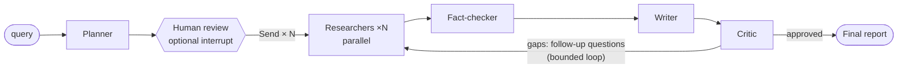

# Multi-Agent AI Research System

A research assistant built with **LangChain** and **LangGraph**. A team of LLM agents plans the research, searches the web and academic sources **in parallel**, fact-checks claims across sources, writes a report with **verifiable citations**, and critiques it, looping back for more research when it finds gaps.

> **Status:** Phases 0–5 are built (78 tests, mypy strict clean): the agent graph, an evaluation harness, a streaming FastAPI backend, a Streamlit UI, a Docker image and GitHub Actions CI. The evaluation harness is verified in dry-run mode, and the real benchmark run is in progress under the free-tier API quota. See [project-notes/](project-notes/README.md) (the full explanation from the basics, with status), [docs/architecture.md](docs/architecture.md), [docs/decisions/](docs/decisions/) and [docs/experiments-log.md](docs/experiments-log.md).

## How it works



| Agent | What it does |
|---|---|
| Planner | Breaks the question into 3–5 focused, searchable sub-questions and a report outline |
| Researcher (×N) | ReAct tool-calling agent (Tavily, DuckDuckGo, arXiv, Wikipedia); returns claims tied to source URLs |
| Fact-checker | Drops claims citing URLs that were never retrieved, scores source credibility, flags contradictions |
| Writer | Writes Markdown with `[n]` markers; code builds the References, so they are correct by construction |
| Critic | Rubric scores (1–5); code decides approval; gaps become new parallel research tasks |

Engineering highlights:
- **Resilience:** per-role model fallback chains, explicit retry policy (no retries on exhausted quotas), graceful degradation, and **SQLite checkpoints, so any crashed run resumes** where it stopped.
- **Human-in-the-loop:** optional plan approval via LangGraph `interrupt`.
- **Streaming API + UI:** runs execute in the background, independent of HTTP connections; progress streams over Server-Sent Events that can be replayed (`Last-Event-ID`), so a closed browser tab never stops a run.
- **Testable by design:** the graph depends only on agent interfaces, so integration tests run the real graph with stub agents in about 8 s, with no API calls.

## Tech stack

LangGraph · LangChain (`create_agent`, middleware, structured output) · OpenRouter (free models) · Groq (optional rescue model; `RS_GROQ_POSITION=first` makes it primary) · Tavily · arXiv · Wikipedia · LangSmith · FastAPI (SSE) · Streamlit · Pydantic · structlog · pytest · mypy (strict) · ruff · uv

## Setup

```bash
uv sync                      # create .venv and install everything
cp .env.example .env         # then paste your API keys
uv run pre-commit install    # lint and clean notebook metadata on commit
```

Keys: `OPENROUTER_API_KEY` and `TAVILY_API_KEY` (required), `LANGSMITH_API_KEY` (tracing, recommended), `GROQ_API_KEY` (optional). All have free tiers. The OpenRouter free tier allows about 50 requests/day, and one research run uses roughly 15–35.

## Usage

```bash
uv run research "How are AI coding agents changing software engineering in 2026?"
uv run research "..." --sub-questions 3 --iterations 1     # cheaper run
uv run research "..." --review                             # approve/edit the plan first
uv run research --resume <thread-id>                       # continue a paused or interrupted run
```

### Web UI

```bash
uv run research-api                          # terminal 1: API on http://127.0.0.1:8000 (docs at /docs)
uv run streamlit run ui/streamlit_app.py     # terminal 2: UI on http://localhost:8501
```

### Docker

```bash
cp .env.example .env          # add your keys (read at runtime, never baked into the image)
docker compose up --build     # API on :8000, UI on http://localhost:8501
```

One image serves both containers. Checkpoints and the LLM cache persist in the `research-data` volume, and reports are written to `./reports` (on Linux hosts, make it writable by UID 1000). The API alone: `docker build -t research-system . && docker run --env-file .env -p 8000:8000 research-system`.

The UI shows a live agent timeline (which researchers are running, follow-up rounds from the critic), an optional plan-approval step, the report with clickable `[n]` citations, a source table with credibility scores, the critic's rubric, per-agent timings, a Markdown download, and the run history from the checkpointer. Interrupted runs (for example when the daily quota runs out) can be resumed with one click. Set `RESEARCH_API_URL` to point the UI at another API.

| Endpoint | Purpose |
|---|---|
| `POST /runs` | Start a run (202) and get a `thread_id` |
| `GET /runs/{id}/events` | Live progress as Server-Sent Events (replayable) |
| `POST /runs/{id}/review` | Approve or narrow the plan of a paused run |
| `POST /runs/{id}/resume` | Continue an interrupted run |
| `GET /runs/{id}` · `/runs/{id}/report` · `/runs` · `/health` | State, Markdown report, history, status |

Reports are saved to `reports/`. Defaults can be overridden with `RS_*` environment variables (see `src/research_system/config/settings.py`).

## Evaluation

The system is benchmarked on 5 research questions of different types (technical, comparative, trend, factual, exploratory), comparing a **single pass** against the **critic loop**:

- **Deterministic metrics:** grounding rate (claims whose cited URLs were actually retrieved), citation problems, sources, domains, critic iterations, LLM calls and tokens.
- **LLM-as-judge:** relevance, completeness and specificity (1–5), on a separate model chain from the writer and critic, to reduce self-preference bias.
- **LangSmith:** the questions live in the `research-system-benchmark` dataset, and every evaluated run's trace carries its scores as feedback.

```bash
uv run research-eval --dry-run            # verify the whole pipeline with stub agents (free)
uv run research-eval --max-runs 2         # real runs; resumable across days, fits the free quota
uv run research-eval --summary            # results table (also written to reports/evaluation.md)
```

## Development

```bash
uv run pytest                 # unit + integration (no network)
uv run pytest -m live         # smoke tests against real APIs (uses quota)
uv run ruff check . && uv run ruff format --check . && uv run mypy src ui
```

CI (`.github/workflows/ci.yml`) runs on every push and pull request. It runs ruff (lint and format), strict mypy and the tests with no API keys. It then builds the Docker image and starts the compose stack, checking that the API and UI health endpoints respond.

## Project layout

```
notebooks/            Phase 1 experiments (01–08), each ending with observations & decisions
src/research_system/  config · schemas · prompts · tools · agents · graph · utils · service · cli
src/research_system/api/   FastAPI app, background run manager, typed client
ui/streamlit_app.py   Streamlit front end (view model in src/research_system/ui/)
tests/                unit · integration (graph, API, UI) · live
src/research_system/evals/  benchmark, metrics, judge, resumable runner, report
docs/                 architecture, decision records (ADRs), experiment log
project-notes/        detailed learning notes: how every part works, status, how to run
Dockerfile, docker-compose.yml, .github/workflows/ci.yml
reports/              generated reports (gitignored)
```

## Roadmap

- [x] Phase 0: Foundation and tooling
- [~] Phase 1: Jupyter experiments (01–06 done; 07–08 real runs pending quota)
- [x] Phase 2: Production implementation
- [~] Phase 3: Evaluation harness done (LangSmith dataset, LLM-as-judge, resumable runner); real benchmark runs pending quota
- [x] Phase 4: FastAPI (SSE) + Streamlit UI
- [~] Phase 5: Docker, compose, CI and ADRs done; demo GIF and benchmark table pending real runs
