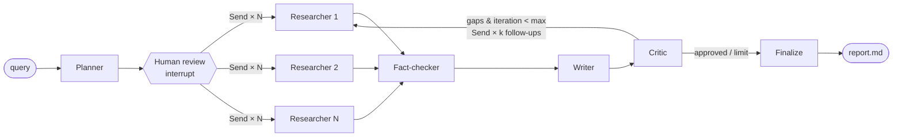

# Architecture

## Overview

A research query goes through a LangGraph state machine of five agents. Agents never call each other. They read and write a shared, typed `ResearchState`, which is checkpointed to SQLite after every step.



| Agent | Model role | Input → output | Deterministic parts |
|---|---|---|---|
| Planner | reasoning | query → `ResearchPlan` (sub-questions + outline) | trimming to `max_sub_questions` |
| Researcher ×N | worker | sub-question → `Finding` (claims with source URLs) | `retrieved_urls` taken from tool outputs |
| Fact-checker | reasoning | findings → `FactCheckReport` | URL grounding, credibility scores |
| Writer | worker | plan + verified claims → `Draft` with `[n]` markers | source numbering |
| Critic | reasoning | plan + draft → `Critique` (rubric 1–5, follow-ups) | approval threshold |
| Finalize | (none) | draft → report | citation validation, References, Limitations |

The guiding principle: **code does what rules can decide, and the LLM is used only for judgement.**

## Package layout

```
src/research_system/
├── config/      settings.py (pydantic-settings), llm.py (LLMFactory: role → model fallback chain)
├── schemas/     Pydantic contracts: plan, search, findings, review, report
├── prompts/     prompt templates (kept apart from logic)
├── tools/       providers.py (Tavily, DDG, arXiv, Wikipedia adapters), research_tools.py (LangChain tools)
├── agents/      planner, researcher, fact_checker, writer, critic + Agents container, build_agents()
├── graph/       state.py, builder.py, options.py (RunOptions), checkpointing.py
├── utils/       citations, sources (credibility), errors (retry policy), logging
├── service.py   ResearchService: start / review / resume / inspect / save (used by CLI and API)
└── cli.py       `uv run research ...`
```

Dependencies point one way: `graph` depends on the `Agents` *interfaces* (`agents/base.py`), never on LLM code. `build_agents()` is the only place real models and tools get wired in, and tests inject stubs at that point.

## Key design decisions

| Decision | Why | Evidence |
|---|---|---|
| Role-based model fallback chains (`reasoning`, `worker`) | Free models are rate-limited or unavailable unpredictably | nb 01: Gemma returned 429 on every call |
| Structured output per model, *then* fallbacks; bounded repair loop | Proxying via fallback wrappers is fragile; validation errors arrive in waves | nb 02 |
| Tools never raise; numbered results with `URL:` lines | The agent can re-route on errors, and citations can be verified | nb 03, nb 04 |
| `Send` fan-out with researchers catching their own errors | `error_handler` doesn't cover `Send` tasks (LangGraph 1.2.17) | nb 05 §9c |
| Error handlers on fact-checker and critic | Degrade gracefully instead of failing the run | nb 07 §6 |
| Explicit `retry_on=is_retryable` | Retry 429/5xx/network errors; never retry daily-quota errors | nb 07; live CLI run |
| SQLite checkpointer with a type allowlist | Resume after a crash or quota stop; no arbitrary deserialisation | nb 07 §3 |
| Run options stored *in state* | Resumed runs keep their original options | Phase 2 |
| Plan edits via validating `with_sub_questions()` | `model_copy(update=)` skips validation, and invalid models are restored with nested dicts | Phase 2 regression test |
| Code-built References | The LLM never writes URLs, so references are correct by construction | nb 06 |

## Error handling summary

| Failure | Handling |
|---|---|
| One model is rate-limited or down | Next model in the role's fallback chain |
| Transient error in a sequential node | `RetryPolicy` (3 attempts, exponential backoff) |
| Daily quota exhausted | No retry; the run stops and is resumable with `--resume` |
| A researcher fails | Recorded under `failures`; the report lists it in "Limitations" |
| Fact-checker fails | Claims are passed through unchecked, with a warning |
| Critic fails | The report is finalized without review, with a warning |
| Invalid structured output | Up to 2 repair attempts with the validation error fed back |
| Runaway agent loop | Tool and model call limits per researcher, `max_iterations`, `recursion_limit` |

## Testing

- `tests/unit`: schemas, settings, tools, fact-checker logic, citations, retry classification, the LLM factory (no network).
- `tests/integration`: the real compiled graph with stub agents, covering parallel research, failures, the critic loop, plan review and crash-resume from SQLite.
- `tests/live` (`-m live`): real APIs, skipped by default.
